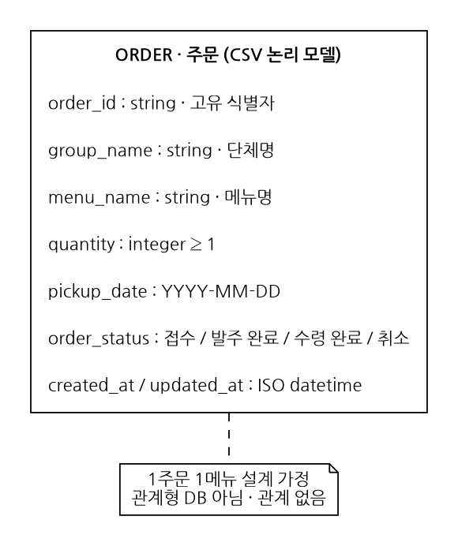
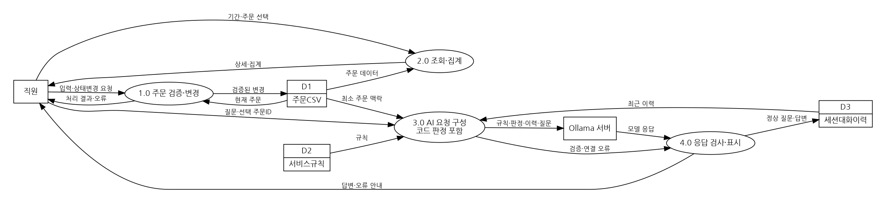

# 개발노트
기준: 1팀 제안서 및 CHAPTER 8 추가사항. 소스와 다이어그램은 개발 초안이며 실행 확인 범위는 QA.md 참조.
GitHub URL: [팀 저장소 URL 입력]
담당자·작성일: [실제 정보 입력]

## 파일 트리
```text
한끼도시락/
├── app.py                  # 관리자 화면 및 AI 패널
├── llm.py                  # 모델 연결과 응답 검사
├── smoke_test.py           # 실제 모델 연결 확인
├── services/
│   ├── __init__.py
│   ├── orders.py           # 검증·기한·상태·집계
│   └── storage.py          # CSV 읽기·원자적 저장
├── support/service_rules.md
├── data/orders.csv         # 첫 저장 시 자동 생성, Git 제외
├── tests/test_core.py
├── requirements.txt
├── .env.example
├── .gitignore
├── README.md
└── docs/
    ├── 개발노트.md
    ├── Draft.md
    ├── QA.md
    └── images/
        ├── erd.png
        ├── dfd.png
        ├── erd.dot
        └── dfd.dot
```

## ERD (CSV 논리 데이터 모델)

ORDER 단일 엔터티, order_id는 애플리케이션 식별자입니다. DB의 PK 제약이 실제 생성되는 것은 아닙니다. 1주문 1메뉴 가정으로 고객·메뉴 테이블을 별도로 만들지 않았습니다. AI 대화는 세션 임시 데이터이며 주문 CSV에 저장하지 않습니다.

## DFD

외부 개체: 직원·Ollama 서버. 프로세스: 주문 검증·변경, 조회·집계, AI 요청 구성, 응답 처리. 저장소: CSV·규칙 파일·세션 이력. AI의 CSV 쓰기 흐름은 없습니다. 주문 맥락은 단체명 등을 제외한 최소 정보만 전달합니다.

## 협업
기능 브랜치 → PR → 동료 검토 → 병합. 실제 PR·Issue 링크와 팀 논의 결과를 별도로 기입합니다. 본 문서가 팀 협의 완료를 의미하지 않습니다.
